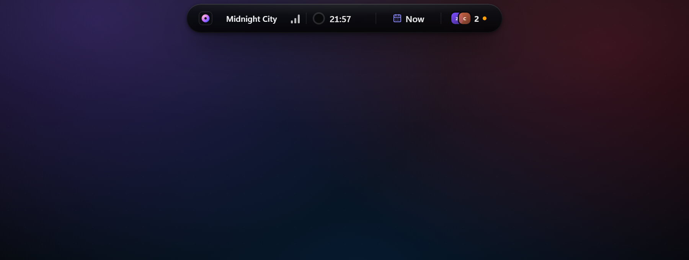
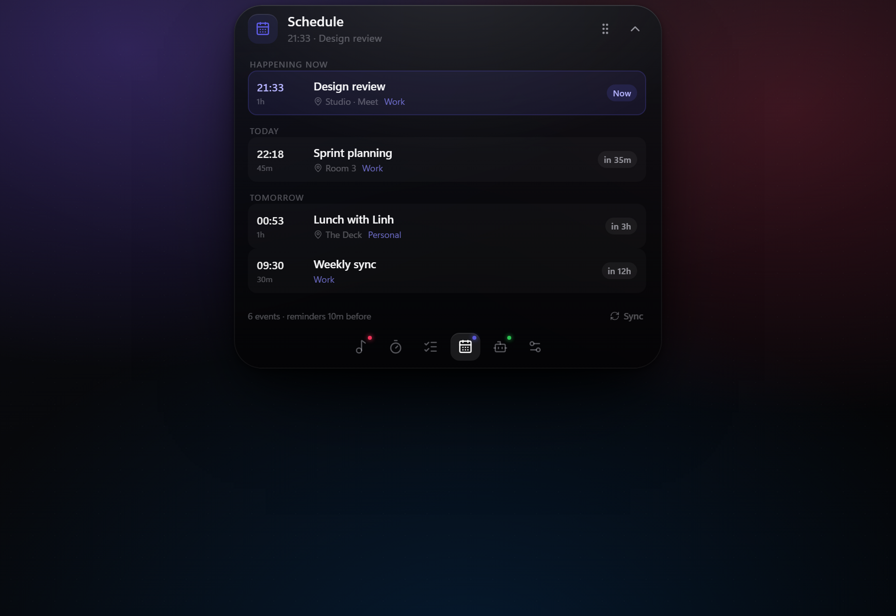

# Dynamic Island for Windows

An always-on-top, iPhone-style Dynamic Island for Windows. It lives in a small
pill at the top of the screen and expands into panels for media, timers, tasks,
calendars and live AI coding agents. When several live activities are running at
once it switches to a compact multi-activity cluster, just like an iPhone.

Built with **Tauri 2** (Rust + WebView2), **React 19**, **Zustand** and
**Vite**, with native Win32 code for the overlay, media sessions, fullscreen
detection and calendar downloads.





## Install

Download the latest Windows installer from
[Releases](https://github.com/d4kw1n/Dynamic-Island-Windows/releases):

- `Dynamic.Island_0.1.0_x64-setup.exe` — Windows 10 1809+ / Windows 11.

The build is not code-signed, so SmartScreen may show "Windows protected your
PC"; choose **More info → Run anyway**. The WebView2 Runtime is required
(included with Windows 11 and most Windows 10 installs).

## Build from source

```powershell
pnpm install
pnpm tauri dev        # hot-reloading desktop app
pnpm tauri build      # release build + installer
```

Requirements: Windows 10 1809+ or Windows 11 with the WebView2 Runtime (included
with Windows 11), Rust 1.82+, Node.js 20+ and pnpm.

## Features

- **Now playing** — Windows System Media Transport Controls (SMTC). Works with
  Spotify, browsers (YouTube, SoundCloud, Apple Music web), VLC, TIDAL and any
  app that exposes a media session. Artwork, play/pause, previous/next and seek.
- **Focus timer** — presets plus a custom duration, progress ring, chime,
  notification and a peek when it finishes.
- **Tasks** — quick add, check off, clear completed. Persisted locally.
- **Notes** — a small scratchpad: create, edit and delete multi-line notes.
  Persisted locally and sorted by the last edit.
- **AI agents** — live session cards for ZCode, Claude Code, Codex and any other
  tool that can POST to the local webhook. The pill only spins while a command
  is actually running; permission prompts open the Agents panel with
  **Deny / Allow once** and your answer goes straight back to the agent.
- **Calendar** — sign in with Google Calendar (read-only) or subscribe to any
  iCal feed (Outlook, iCloud, a local `.ics` file). Upcoming events, an
  in-progress highlight and reminder peeks/notifications before an event
  starts.
- **Multi-activity cluster** — at least two live activities collapse into one
  pill with dividers (media, timer, calendar, agents). Each segment opens its
  own panel; hovering a segment chooses the panel for hover-expand.
- **Does not take over the screen** — translucent surface, compact panels,
  auto-collapse, draggable position (saved and clamped to the monitor), and the
  whole island hides when a true fullscreen app is in the foreground. An
  expanded panel near a monitor edge nudges the window back so it never gets
  clipped by the screen border.
- **Native feel** — frameless, always-on-top but never steals focus, per-region
  click-through so the transparent window does not block the desktop, tray menu,
  launch at login, Windows notifications.
- **Browser preview** — `pnpm dev` renders the whole UI with mock data, which is
  handy for screenshots and styling (`?expanded=1&tab=calendar`, `?seed=timer`).

## Architecture

```
src/                     React UI
  components/Island.tsx  pill/panel morph, cluster, drag, hit-rect sync
  components/*Panel.tsx  media, timer, tasks, calendar, agents, settings
  store/useStore.ts      zustand state + persistence payload
  lib/bridge.ts          Tauri invoke/listen + browser-preview mocks
src-tauri/src/
  media.rs               SMTC session polling, controls, artwork -> base64
  agents.rs              local webhook (axum) + session state machine
  hooks.rs               hook shim + installer for Claude/ZCode/Codex
  calendar.rs            WinHTTP feed download + iCalendar parser/expander
  google.rs              Google OAuth (PKCE) + Calendar API sync
  procs.rs               process detection for agent apps
  fullscreen.rs          foreground fullscreen/monitor polling
  windowing.rs           overlay window, placement, drag, click-through
  store.rs               state.json persistence
```

### Event channels

| Event | Direction | Payload |
| --- | --- | --- |
| `media://update` | Rust → UI | media snapshot |
| `media://artwork` | Rust → UI | `{ key, data }` data URL |
| `agents://update` | Rust → UI | agent session list |
| `agents://sources` | Rust → UI | running agent apps |
| `agents://error` | Rust → UI | webhook error text |
| `calendar://update` | Rust → UI | calendar snapshot |
| `island://fullscreen` | Rust → UI | `true` while a fullscreen app is active |
| `island://open-settings` | Rust → UI | tray menu command |

The window is a transparent rectangle much larger than the pill, so the UI
reports the island's rounded rectangle (CSS px, scaled for DPI) to Rust. Two
mechanisms keep everything outside it click-through:

- `WM_NCHITTEST` answers `HTTRANSPARENT` outside the rect. This only covers
  areas owned by the root HWND — WebView2's child windows normally win
  hit-testing first.
- A 16 ms cursor poll toggles `WS_EX_TRANSPARENT | WS_EX_LAYERED` on the root
  HWND whenever the cursor leaves the rect, which makes Windows skip the whole
  window (children included). Clicks reach the app underneath; over the island
  the bits are cleared again. The poll pauses while a mouse button is held, so
  dragging the pill is never interrupted.

## Agent integration

Open **Settings → Agent hooks** and press **Connect** for the tool you use.
This edits the tool's own config (a timestamped backup is written first):

| Agent | File | Mechanism |
| --- | --- | --- |
| Claude Code | `~/.claude/settings.json` | command hooks for session/tool/permission events |
| ZCode | `~/.zcode/cli/config.json` | process hooks (`--hook zcode`) for 7 lifecycle events |
| Codex | `~/.codex/config.toml` | `notify` array (turn completion only) |

Each hook runs the same executable with `--hook <agent>`. The shim reads the
JSON payload from argv or stdin, POSTs it to `127.0.0.1:17321`, never writes to
stdout and exits immediately — except for **permission requests**: those block
the agent and print a decision only when you answer in the island.

The pill stays visible for the whole turn. It shows **Working** (spinning
ring) only while a tool actually runs between `PreToolUse` and `PostToolUse`,
and **Thinking** (calm blue dot, no spinner) while the model reasons between
tools, so the agent does not blink in and out. A finished turn shows **Done**;
a session that was started but never prompted stays hidden.

ZCode writes the hook payload to **stdin** (Claude-compatible fields plus
camelCase aliases such as `sessionId`/`toolName`). Its `PermissionRequest` hook
accepts the same `hookSpecificOutput.decision` object that Claude Code uses, so
Allow/Deny works for both. Terminal events for a session the island never saw
(the app was restarted mid-turn) are ignored instead of creating a phantom
Done card, and sessions are named after the nearest git repository root.

> **Permission prompts.** When Claude Code (or ZCode) needs approval, the island
> opens the Agents panel with the exact command and four choices: **Deny**,
> **Always allow** (this exact command/path, saved as a project rule),
> **Allow all <tool>** (every use of that tool in the project) and **Allow
> once**. Your answer is returned to the agent as its hook decision; ignoring
> the card for 75 seconds falls back to the agent's own prompt. ZCode's
> **Full access** entry is a collaboration-mode switch guarded by its own V4
> approval, not a permission decision, so hooks cannot activate it — use
> Allow all <tool> or switch the mode inside ZCode.
>
> **Restart the agent after connecting.** Hook files are read when a session
> starts, so a session that was already running will not send events. The
> Agents panel also shows "Detected · not reporting yet" for this case.
>
> Each row in **Settings → Agent hooks** reports its state. **Connected** means
> the installed hooks point at the executable that is currently running.
> **Reconnect** means they point somewhere else — typically after moving the
> app or switching from a debug build to the release build. Pressing it
> replaces the stale entry instead of duplicating it. The trash button
> **disconnects** the adapter: it removes only the island's own entries, leaves
> the rest of the file untouched and writes a timestamped backup
> (`*.island-backup-YYYYMMDD-HHMMSS`) first.

### Webhook for any other agent

```
POST http://127.0.0.1:17321/v1/agent/event
Content-Type: application/json

{
  "agent": "antigravity",
  "event": "tool_start",
  "session_id": "session-1",
  "task": "Refactor the settings panel",
  "tool": "Edit",
  "detail": "src/components/SettingsPanel.tsx",
  "message": "",
  "cwd": "D:\\Dev\\my-project",
  "model": "Gemini"
}
```

`event` may be `SessionStart`, `UserPromptSubmit`, `PreToolUse`,
`PermissionRequest`, `PostToolUse`, `PostToolUseFailure`, `Stop`,
`SessionEnd`, `tool_start`, `tool_end`, `working`, `waiting`, `done`, `error`
or `update`. Unknown events only refresh metadata. `detail` accepts a string or
the raw tool-input object. `GET /v1/health` returns `ok`. The webhook is
unauthenticated and bound to loopback only.

To raise an interactive approval, send `event: "PermissionRequest"` with a
`request_id`; the HTTP request then waits (up to 75 s) and answers
`{"decision":"allow"|"deny"|""}` once the island's buttons are used. That is how
the Claude Code and ZCode shims turn an island click into the agent's hook
decision.

Antigravity, ChatGPT and Gemini desktop apps are discovered by process name and
shown as "monitoring only" because they do not expose a local event API.

## Calendar setup

### Google Calendar (sign-in)

1. In the [Google Cloud Console](https://console.cloud.google.com/apis/credentials)
   create an **OAuth client ID → Desktop app** and enable the **Google Calendar
   API** for the project.
2. Add `http://127.0.0.1:17321/oauth/google/callback` as a redirect URI (desktop
   clients accept loopback with any port, but the path must match).
3. Open **Settings → Calendar**, paste the client ID and client secret and press
   **Connect**. The system browser opens; approve the read-only Calendar scope.
   The callback page confirms the connection and the island starts syncing.
4. Use the trash button next to **Connected** to sign out. The refresh token is
   stored locally and can be revoked from your Google account at any time.

The next 14 days of every calendar visible in Google Calendar (up to 12,
including shared/subscribed ones) are read, read-only. A configured iCal link
takes precedence over the Google connection.

### iCal feeds

1. Copy a read-only iCal URL:
   - **Google Calendar**: Settings → your calendar → *Secret address in iCal
     format*.
   - **Outlook / Microsoft 365**: Calendar settings → *Publish a calendar* →
     copy the ICS link.
   - **iCloud**: Calendar → Share → *Public Calendar* → copy the `webcal://`
     link (the app converts it to `https://`).
   - **Local file**: any `.ics` path, for example `D:\calendar.ics`.
2. Open **Settings → Calendar**, paste the URL and press **Save**.
3. Choose the reminder lead time (Off / 5 / 10 / 15 / 30 minutes).

The feed is fetched with WinHTTP through the system proxy every 45 seconds and
on demand with **Sync**. Events are expanded for the next 14 days, including
daily/weekly/monthly/yearly recurrence rules with `COUNT`, `UNTIL`, `BYDAY`,
`BYMONTHDAY` and `EXDATE`. When an event is close (or already running) it joins
the collapsed cluster, and the reminder shows a peek, plays the chime and sends
a Windows notification.

Notes:

- Named TZIDs are interpreted as local wall time. This is correct for a feed
  that exports your own calendar in your own timezone; it can be off by the
  timezone offset for events in another zone.
- Modified single occurrences (`RECURRENCE-ID` overrides) are not merged back
  into the series. The base occurrence is shown instead.
- The feed URL is stored in `state.json` (it is a secret address; treat it like
  a password).
- Google OAuth credentials and tokens are stored in `google.json` next to
  `state.json`. The client secret of a desktop OAuth client is not confidential,
  but the refresh token is — sign out before sharing your profile.

## Persistence and data

Everything is local:

```
%APPDATA%\com.d4kw1n.dynamicisland\state.json
```

Stores tasks, notes, timer, settings, calendar feed URL and the last island
position.
The app writes through a temp file and renames, so a crash cannot leave a
half-written state file.

Agent sessions live in memory. Finished and failed cards stay for 15 minutes,
idle sessions for 5 minutes, and the webhook sweep drops them automatically, so
a forgotten test post does not linger forever.

## Development notes

- `pnpm dev` — browser preview with mock media/agents/calendar.
- `pnpm build` — TypeScript check + production frontend build.
- `pnpm tauri dev` — native development app (loads the Vite dev server).
- `pnpm tauri build` — installer plus release binary. If you build Rust directly
  instead, pass the feature or the binary stays in dev mode and shows a blank
  window: `cargo build --release --features custom-protocol`.
- `dynamic-island.exe --ics-check D:\path\file.ics` (debug builds only) parses a
  feed and writes the result to `%TEMP%\island-ics-check.json`.
- `?expanded=1&tab=settings` opens a panel directly;
  `?seed=timer` starts a timer for cluster screenshots.

## Troubleshooting

| Symptom | Fix |
| --- | --- |
| Agents panel says "Hooks ready" but nothing appears | Restart the agent session; hooks load at session start. |
| Settings shows **Reconnect** instead of Connected | The hooks point at another executable (moved app, debug vs release build). Press Reconnect. |
| Permission prompt never appears in the island | Reconnect the hooks (the permission event needs the new timeout), then restart the agent session. |
| Allow/Deny in the island does nothing | The agent fell back to its own prompt (75 s passed or the hook is not installed). Restart the session and try again. |
| An adapter should stop reporting | Settings → Agent hooks → trash button (Disconnect). Only the island's entries are removed. |
| Calendar shows an error | Check the URL is a read-only ICS link; use Sync. The last good schedule is kept while offline. |
| Google Calendar returned HTTP 403 | Enable the **Google Calendar API** for the same Cloud project as the OAuth client (the error text links to it), wait a minute, then press Sync. |
| Island covers a taskbar or is off-screen | Drag it, or Settings → Island position → **Center**. Positions are clamped to the monitor. |
| Island does not hide in a game | Some exclusive-fullscreen games report no window rect; use borderless fullscreen. |
| Notifications do not appear | Enable notifications for Dynamic Island in Windows Settings. |
| Media is empty | The player must publish an SMTC session; browsers need an active tab playing audio. |

## Known limitations

- Windows only (WinRT SMTC, WinHTTP, Win32 overlay).
- Recurrence expansion is bounded to the 14-day reminder window and 80 events.
- Codex reports only turn completion (`notify` has no lifecycle hooks).
- Google Calendar sign-in needs your own desktop OAuth client, reads the next 14
  days of the calendars visible in Google Calendar and is read-only (no event
  creation).
- Permission decisions are returned as a `PermissionRequest` hook decision;
  Claude Code supports this natively, ZCode accepts the same shape best-effort.
- The local webhook has no authentication (bound to `127.0.0.1`).

## Roadmap

- Outlook/Microsoft Graph OAuth and Google Calendar OAuth.
- Multiple calendar subscriptions with per-calendar colors.
- Reminder snooze and "join meeting" links.
- Optional idle mascot and richer sound pack.

## License

[MIT](LICENSE) © 2026 d4kw1n.
